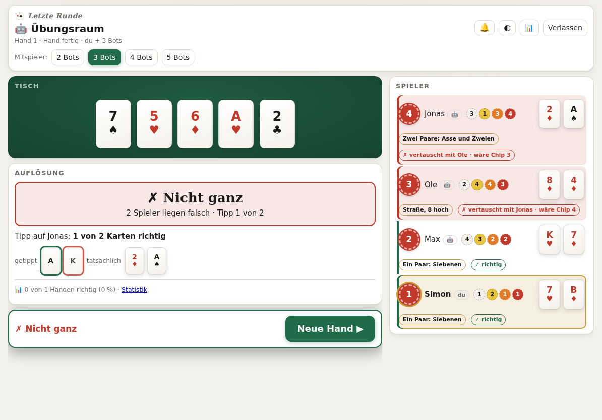
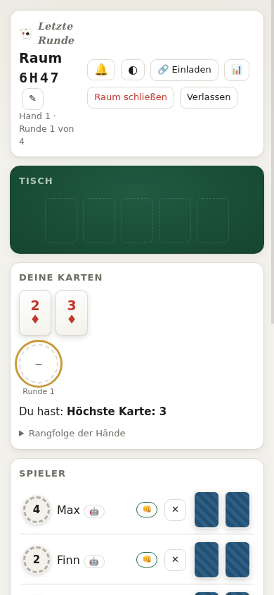
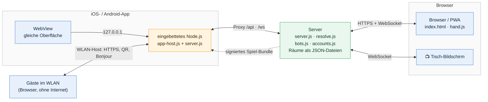

# Letzte Runde

Kooperatives Pokerkarten-Spiel für den Browser – inspiriert von „The Gang“. Alle spielen **zusammen**: Jede Runde nimmt sich jeder einen Chip von 1 (schwächste Hand) bis n (stärkste Hand). Am Ende wird aufgedeckt – stimmt die Reihenfolge, hat die Gruppe gewonnen.

**Status:** Web live · iOS im App Store · Android als APK (Play Store folgt) · aktive Entwicklung

## So kommst du dran

| | |
|---|---|
| **Browser** | [letzterunde.aize-it.de](https://letzterunde.aize-it.de) – ohne Anmeldung, auf Handy, Tablet und PC, als PWA installierbar (früher gang.aize.eu, leitet weiter) |
| **iPhone / iPad** | [App Store](https://apps.apple.com/de/app/letzte-runde-kartenspiel/id6823285737) |
| **Android** | [APK über GitHub](https://github.com/sgitaize/letzte-runde/releases/latest/download/letzte-runde.apk) – die App meldet neue Versionen selbst; Play-Store-Version folgt |

<p>
  
  
</p>

## Funktionen

- **Räume mit Code und Link** – öffentlich unter „Offene Räume“ oder privat (nur mit Code/Link), der eigene Raum ist dort mit „📍 Du bist hier“ markiert; Einladung per Link/QR-Code mit Vorschau in WhatsApp & Co., Raumnamen, geplante Räume mit Startzeit (Zeitzone des Planenden), Zuschauen, Einspringen für Spieler, die offline gegangen sind
- **Tisch-Modus für den großen Bildschirm** – ein PC, Fernseher oder Monitor tritt mit „📺 Als Tisch“ (oder Link `…/?tisch=CODE`) bei und zeigt Tisch, Chips in der Mitte und alle Spieler*innen rund um den Tisch groß an; am Handy lässt sich der Tisch dann mit „📺 Tisch ausblenden“ wegschalten (nur Hand, Chips, Insight)
- **Nächster Schritt** – eine Leiste unten sagt in jeder Phase, was gerade zu tun ist („Nimm einen Chip“, „Bereit klopfen“, „Tipp bestätigen“, „Aufdecken“), springt per Knopf zur Stelle oder erledigt einfache Schritte direkt
- **Ablauf wie am Tisch** – 4 Runden (Hand, Flop, Turn, River), Chips aus der Mitte oder von anderen nehmen, „👊 Bereit“ und 3-2-1-Countdown, gemeinsamer Tipp auf die Karten des höchsten Chips – mit Vorschlägen je Spieler*in (auch der Bots), live für alle und am Tisch-Bildschirm, mit einem Tipp übernehmbar –, Aufdecken mit 10-s-Countdown
- **Hausregeln** – eine Kombination zählt nur, wenn die eigenen Karten sie verbessern (ein Paar nur auf dem Tisch zählt nicht); liegt auf dem Tisch schon mehr (z. B. eine Straße), zählt die beste eigene Kombination; Flush und Straße nach der eigenen höchsten Karte benannt
- **Bots** – Singleplayer allein gegen 2–5 Bots (läuft komplett im Browser, auch **offline**) und Bots zum Auffüllen echter Räume. Bots schätzen ihre Hand per Monte-Carlo-Simulation, verhandeln um Chips und merken sich Absprachen über die Runden
- **Lernmodus** im Singleplayer – zeigt, was die eigene Hand wert ist, welcher Chip passt und nach der Hand, warum etwas anders gehört
- **Statistik** – Quote, Serien, „fast richtig“ (Reihenfolge stimmt, Tipp teilweise getroffen – zählt halb, ohne Feier-Animation), Tipp-Treffer, Treffsicherheit je Runde; ausklappbar „Nutzung & Erfolgsrate“: Spieltage, Hände nach Wochentag und Tageszeit, Anteil richtiger Reihenfolge und richtiger eigener Hand je Tag
- **Konten (freiwillig)** – nur Name + Passwort, keine E-Mail; Statistik aus Übungsraum und Räumen liegt im Konto und ist auf jedem Gerät da. Freunde per Freundescode/Link oder direkt im Raum (👥+ neben angemeldeten Mitspielenden, mit Bestätigung) und Bestenliste unter Freunden (7 Tage/insgesamt, Übung/Räume). Passwort vergessen: einmaliger Wiederherstellungscode (bei der Registrierung angezeigt) oder Zurücksetzen durch Admins
- **Spiellogik nachladen (Apps)** – Wertung, Bots und Oberfläche lassen sich ohne Store-Release aktualisieren: der Server bietet ein signiertes Bundle an, die App zeigt es beim Start, lädt nur geänderte Dateien und spielt danach damit – auch offline und im WLAN. Das mit dem Release eingebaute Spiel läuft immer ohne Server. Im Admin lässt sich für Online-Räume eine Mindestversion verlangen
- **Verbindliche Auswertung** – der Server rechnet jede fertige Hand selbst nach (aufgedeckte Karten entschlüsselt) und legt das Ergebnis für alle in den Raum; die Statistik hängt nicht mehr von der Version des meldenden Geräts ab
- **Kauf mir eine Spezi** – freiwilliges Trinkgeld auf der Startseite (Eine Spezi, Tagesration, Kasten): im Browser und in der Android-App über den Spendenlink aus dem Admin, in der iOS-App per In-App-Kauf; schaltet nichts frei
- **Extras** – Chat mit Ton, schnelle Reaktionen (👍 😂 😬 🤔 🔥), optionaler Voice-Chat (WebRTC, direkt zwischen den Geräten, mit Einwilligung), Hell/Dunkel, Querformat-Layout für Tablets

## Fair und sicher

- **Kein Server kennt die Karten.** Das Geben ist auf drei Spieler verteilt (Mischen, Verteilen A, Verteilen B; ECDH P-256 + AES-GCM im Browser). Keine Rolle allein kann eine fremde Karte lesen; aufgedeckte Karten prüft jeder Browser selbst nach. Bots übernehmen nur Rollen, wenn weniger als drei Menschen spielen.
- **Rechte serverseitig geprüft** – Geräteschlüssel je Spieler, Host-Rechte, keine fremden Plätze oder Chips.
- **Absturzsicher** – Größen- und Tiefengrenzen für Eingaben, Anfragebremse je IP, WebSocket-Grenzen, Speicherbremse, Log-Rotation.
- **Datensparsam** – keine Cookies, kein Tracking; Räume werden nach 48 Stunden ohne Aktivität gelöscht.

## Architektur



**So funktioniert es**
- **Das ganze Spiel steckt im Client** (`index.html`, `hand.js`): Oberfläche, Protokoll, Singleplayer mit Bots und Lernmodus. Der Singleplayer läuft dadurch komplett offline.
- **Der Server ist nur Treffpunkt:** Räume, Rechteprüfung, WebSockets, Bots zum Auffüllen und Konten. Die Karten kennt er nicht: Gemischt und verteilt wird verschlüsselt unter drei Spieler*innen (ECDH P-256 + AES-GCM). Erst nach dem Aufdecken rechnet `resolve.js` jede Hand verbindlich nach.
- **Die Apps** zeigen dieselbe Oberfläche in einer WebView und bringen ein eigenes Node.js mit (nodejs-mobile). Online leitet es `/api` und `/ws` an den Server weiter, offline hostet es Räume im WLAN – Gäste ohne App spielen im Browser mit.
- **Spiellogik-Updates ohne Store:** Der Server bietet ein mit Ed25519 signiertes Bundle an; die App prüft Signatur und Prüfsummen, lädt nur Geänderte nach und fällt bei Problemen auf das eingebaute Spiel zurück.
- **Konten sind freiwillig** (Name + Passwort, verschlüsselt gespeichert); Hände aus Übung und WLAN werden nur mit Zustimmung nachgereicht.

| Baustein | Ort | Aufgabe |
|---|---|---|
| Spiel (Client) | `app/public/index.html`, `hand.js`, `sw.js` | UI, Protokoll, Singleplayer, Handbewertung (gemeinsam mit dem Server), Offline-Cache |
| Server | `app/server.js` | HTTP + WebSocket, Räume als JSON-Dateien, Rechte, Grenzen, Zähler |
| Auswertung | `app/resolve.js` | entschlüsselt aufgedeckte Karten und wertet jede Hand verbindlich aus |
| Bots | `app/bots.js` | Mitspielende im Raum (Monte-Carlo, Absprachen) |
| Konten | `app/accounts.js` | scrypt-Passwörter, Wiederherstellungscode, Statistik, Freunde |
| App-Host | `app/app-host.js` | Proxy, WLAN-Host mit eigenem Zertifikat, Spiel-Bundle nachladen |
| Spiel-Bundle | `app/bundle-manifest.js`, `app/scripts/bundle.js` | Dateiliste, Prüfsummen, Signatur |
| iOS-App | `native/ios/` | SwiftUI-Hülle: WebView, Node, Bonjour/QR, Haptik, In-App-Kauf |
| Android-App | `native/android/` | Kotlin-Hülle: WebView, Node, WLAN, Update-Hinweis |
| Tests | `tests/` | End-to-End, Angriffe, Bots, Voice, Offline, Bundle |

Mehr Details: [docs/app-architektur.md](docs/app-architektur.md).

## Starten

Voraussetzung: **Node.js ≥ 18**. Keine Abhängigkeiten, kein Build.

```bash
cd app
node server.js            # http://localhost:3000
```

| Umgebungsvariable | Bedeutung |
|---|---|
| `PORT` | Port (Standard 3000) |
| `ADMIN_SECRET` | Passwort für `/admin.html`; ohne Angabe wird eines erzeugt und in `app/data/admin-secret.txt` abgelegt |
| `KR_ACCT_SECRET` | Geheimnis (mind. 32 Zeichen) für Passwort-Pepper und Verschlüsselung der Konten; ohne Angabe wird eines in `app/data/account-secret.txt` erzeugt. **Sichern** – ohne dieses Geheimnis sind alle Konten unlesbar |
| `KR_MEM_MB` | Speichergrenze in MB, ab der keine neuen Räume angenommen werden (Standard 350) |

Einstellungen wie Spielerzahl, Handkarten, Tipp und Voice-Chat stehen im Admin-Bereich (`/admin.html`).

**Hosting:** Läuft z. B. unter Plesk/Phusion Passenger (Application Root `app/`, Document Root `app/public/`, Startdatei `server.js`). Für WebSockets den nginx-Proxy-Modus ausschalten; ohne WebSockets fällt das Spiel automatisch auf Abfragen im Sekundentakt zurück. `deploy.sh` ist ein Beispiel für ein Deployment per FTPS (Zugangsdaten aus einer lokalen `.env`, nicht im Repo).

## Tests

```bash
tests/run.sh
```

Startet alle Testreihen parallel (je eigener Server) und gibt je Reihe eine Zeile aus; Details landen in `/tmp/kr-tests/`. Enthalten sind komplette Hände mit simulierten Browsern, Angriffe auf den Server, Bots in echten Räumen, Singleplayer und Lernmodus, die Server-Auswertung, das Nachladen der Spiellogik in der App sowie Voice-Chat und Offline-Modus in echtem Chromium (übersprungen, wenn `chromium` fehlt). `tests/shot.js` erstellt Screenshots in mehreren Bildschirmgrößen, `tests/shot-features.js` Bilder der neuen Funktionen (liegen in [docs/screenshots/1.1/](docs/screenshots/1.1/)).

## Spiellogik für die Apps nachladen

Einmalig: `node app/scripts/bundle.js keygen` – der private Schlüssel landet in `~/.letzte-runde/bundle-key.pem` (sichern, nie ins Repo; auf dem Deploy-Rechner als `KR_BUNDLE_KEY` in `.env`), der öffentliche in `app/bundle-key.pub` (committen, **vor** dem App-Build – ohne ihn laden die Apps keine Updates, spielen aber normal).
Danach bei jedem `./deploy.sh`: Bundle bauen, signieren, hochladen; die Apps bieten es beim nächsten Start an. Bei einer Regeländerung `LOGIC_VERSION` in `hand.js` erhöhen; im Admin lässt sich dann „Update für Online-Räume erzwingen“.

## Status & nächste Schritte

- **Live:** Web 1.1 · Android-APK 1.1.0 · iOS 1.0.1 im Store, 1.1.0 in der Prüfung
- **Geplant:** kompakteres Layout für kleine Handys ([#6](https://github.com/sgitaize/letzte-runde/issues/6)), Push-Benachrichtigungen ([#7](https://github.com/sgitaize/letzte-runde/issues/7)), Play Store
- Ideen und Fehler gerne als [Issue](https://github.com/sgitaize/letzte-runde/issues)

## Lizenz

[MIT](LICENSE) © 2026 Simon Gutjahr. Enthält den [QR Code Generator](https://github.com/kazuhikoarase/qrcode-generator) von Kazuhiko Arase (MIT).

„The Gang“ ist ein Spiel von Kosmos; dieses Projekt ist eine unabhängige, nicht-kommerzielle Umsetzung und steht in keiner Verbindung dazu.
